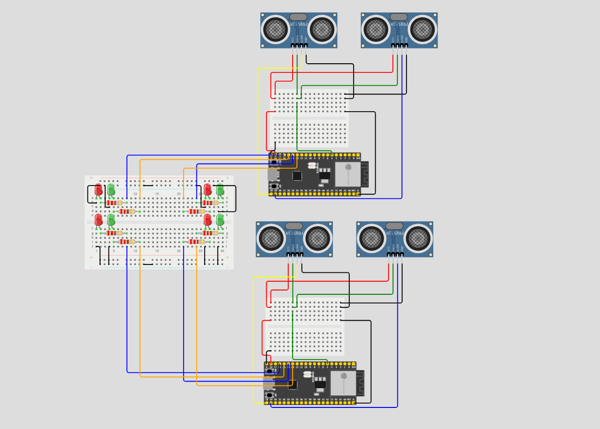

# Estacionamento Inteligente com Monitoramento em Tempo Real

> **Projeto Integrado de Computação I - PIC I**

## Resumo do Projeto

O projeto consiste no desenvolvimento de uma maquete de estacionamento inteligente utilizando sensores, atuadores e microcontroladores. Sendo **dois módulos ESP8266**, onde cada módulo é responsável pelo monitoramento descentralizado de 4 vagas (totalizando 8 vagas).

A partir da leitura de sensores ultrassônicos, o sistema identifica se uma vaga está livre ou ocupada, acende LEDs indicativos locais e atualiza um monitor central para que o usuário acompanhe a capacidade do estacionamento em tempo real.

## Funcionalidades

* **Detecção de Ocupação:** Monitoramento individual de cada vaga em tempo real.

* **Sinalização Visual Local:** LEDs em cada vaga indicando o status atual (Ex: Verde para Livre, Vermelho para Ocupada).

* **Processamento Distribuído:** Uso de 2x ESP8266 dividindo a carga de leitura (4 vagas por microcontrolador).

* **Interface de Contagem:** Exibição centralizada da quantidade de vagas disponíveis. Integrado via Wi-Fi, ao HiveMQ WebSocket, pelo protocoloc MQTT.

## Lista de Componentes (Hardware)

Abaixo está a lista atualizada de materiais utilizados no protótipo:

| Qtd. | Componente | Função no Projeto | 
| ----- | ----- | ----- | 
| **2** | **Módulo ESP8266** (NodeMCU/Wemos) | Microcontroladores com Wi-Fi. Cada um processa e controla os dados de 4 vagas. | 
| **4** | Sensores Ultrassônicos HC-SR04 | Detecção da presença de veículos nas 8 vagas da maquete. | 
| **4** | LEDs | Indicação visual do estado individual de cada vaga. | 
| **4** | Resistores | Controle da corrente nos LEDs | 
| **1** | Monitor | Exibição das vagas disponíveis. Conectado ao HiveMQ. | 
| **-** | Protoboards e Cabos Jumper | Montagem e interligação elétrica dos componentes. | 
| **1** | Cabo USB | Alimentação dos microcontroladores e periféricos. | 
| **1** | Estrutura da Maquete | Base e divisórias físicas para representar o estacionamento. | 

## Arquitetura do Sistema

A arquitetura foi dividida para contornar a limitação de portas (GPIOs) e otimizar a leitura dos sensores:

1. **Nó 1 (ESP8266 A):** Lê 2 sensores ultrassônicos, controla 2 LEDs de status.

2. **Nó 2 (ESP8266 B):** Lê 2 sensores ultrassônicos, controla 2 LEDs de status.

3. **Comunicação / Exibição:** Os dois módulos ESP8266 podem se comunicar via rede Wi-Fi (ex: protocolo MQTT, requisições HTTP, ou ESP-NOW) para somar as vagas livres e enviar a informação final ao monitor.

*(Insira aqui a imagem do seu esquemático elétrico atualizado para o ESP8266)*

 

## Como executar o projeto

### Pré-requisitos

* [Arduino IDE](https://www.arduino.cc/en/software) ou [VS Code com PlatformIO](https://platformio.org/).

* Pacote de placas do **ESP8266** instalado na IDE.

* Bibliotecas para o sensor ultrassônico: HC-SR04.

### Passos

1. Clone este repositório:

   ```
   git clone https://github.com/tiagorosemberg/Estacionamento-Inteligente
   
   ```

2. Abra o arquivo do código fonte `.ino` na sua IDE.

3. Configure as credenciais de Wi-Fi (SSID e Senha) no código, caso esteja utilizando comunicação via rede.

4. Conecte o primeiro ESP8266 ao computador, selecione a placa correta e a porta COM, e faça o upload do código referente ao "Nó 1".

5. Repita o processo para o segundo ESP8266 com o código do "Nó 2".

6. Monte o circuito conforme o esquemático elétrico e ligue a alimentação.

## Membros do Grupo

* Daniel Schwartz Cantarella

* Tiago Rosemberg Barcellos

* Pedro Bindaco Olioza
